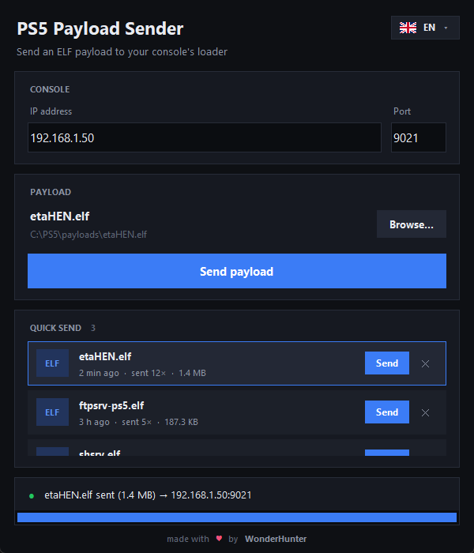

# PS5 Payload Sender

A tiny desktop app to send ELF payloads to a PS5 payload loader. It does the same thing as
`ncat -w 1 <ip> 9021 < payload.elf`, but in a window, with one-click resend.



## Features

- Enter the console's IP and port (default `9021`). Both are remembered.
- Pick an `.elf` and send it, with a progress bar and clear error messages.
- **Quick send**: every payload you send is kept in a list, so you can resend it in one click.
- Desktop notification when a send succeeds or fails.
- 15 languages with a flag picker: English, Français, Español, Português, Deutsch, Italiano,
  Nederlands, Polski, Türkçe, Русский, Українська, العربية, 日本語, 简体中文, 한국어.
- Single portable executable: no install, no Python needed.

## Download

Grab the latest build from the [Releases](https://github.com/WonderHunter/ps5-payload-sender/releases/latest) page:

| Platform | File |
| --- | --- |
| Windows | `PS5PayloadSender-windows-x64.exe` |
| macOS (Apple Silicon) | `PS5PayloadSender-macos-arm64.dmg` |
| macOS (Intel) | `PS5PayloadSender-macos-x64.dmg` |
| Linux (any distro) | `PS5PayloadSender-x86_64.AppImage` |
| Debian / Ubuntu | `PS5PayloadSender-linux-x86_64.deb` |
| Linux (plain binary) | `PS5PayloadSender-linux-x86_64.tar.gz` |

The builds are not code-signed:

- **Windows**: SmartScreen may warn on first launch. Click *More info* → *Run anyway*.
- **macOS**: right-click the app → *Open* the first time.
- **Linux AppImage**: `chmod +x PS5PayloadSender-x86_64.AppImage` then run it.

## Usage

1. Start the payload loader on your PS5. It listens on port `9021` by default.
2. Enter the console's IP address.
3. Click **Browse…**, pick a payload, then **Send payload**.
4. Next time, use the **Send** button next to the payload in the *Quick send* list.

Settings are stored in:

- Windows: `%APPDATA%\PS5PayloadSender\config.json`
- macOS: `~/Library/Application Support/PS5PayloadSender/config.json`
- Linux: `~/.config/ps5-payload-sender/config.json`

## Run from source

Requires Python 3.10+ with Tkinter.

```bash
python ps5_payload_sender.py
```

To build an executable locally:

```bash
pip install pyinstaller pillow
pyinstaller --onefile --windowed --name PS5PayloadSender --icon icon.ico --add-data "icon.ico:." --add-data "icon.png:." ps5_payload_sender.py
```

## Releases

The [Build workflow](.github/workflows/build.yml) builds every platform on each push.
Pushing a tag like `v1.2.0` also publishes a GitHub release with all the files attached:

```bash
git tag v1.2.0
git push origin v1.2.0
```

## License

[MIT](LICENSE): you're free to use, modify and redistribute this project, as long as you keep the
copyright notice crediting WonderHunter.

---

made with ♥ by [WonderHunter](https://github.com/WonderHunter)
